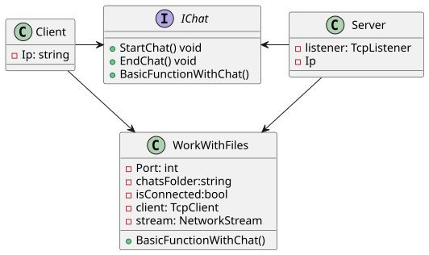
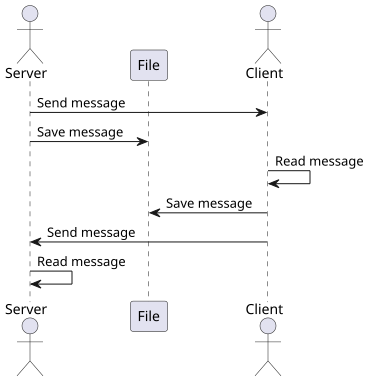

# Chat

В цій курсовій роботі реалізовано базовий чат між двома комп'ютерами в локальній мережі , під'єднаними через TCP протокол. 

TCP(Transmission Control Protocol) – протокол передачі даних по мережі, який працює разом з протоколом IP. 

IP (nternet Protocol) — протокол мережевого рівня для передавання датаграм між мережами.

## Функціонал:
- Надсилання повідомлень
- Запис повідомлень у файл
- Видалення чату
- Перегляд історії чату в консолі

### Початок роботи
Користувач потрапляє в початкове меню з вибором: бути сервером чи клієнтом. Далі потрібно ввести порт до якого підключитись або 0 - це означає що підключення буде на предбачений порт (8888), і Ip-адресу, якщо був вибраний режим клієнта.
## Основне меню
Після вибору режиму роботи потрапляємо до меню вибоу: 
1. Start Chat
2. Show chat
3. Show all chats
4. Delete chat
5. Stop program
6. Clear Console
## З'днання з клієнтом
Якщо користувач вибрав режим сервер, тоді з'явиться рядок, в якому сказано, що сервер запущено за Ip-адресою і портом, та очікування клієнта. Далі клієнт має під'єднатись за вказаною адресою і портом. Якщо клієнт під'єднався з'явиться відповідне повідомлення. Щоб розпочати надсилати потрібно натиснути Enter. Щоб закінчити Escape.
## З'днання з сервером
Якщо був обраний режим клієнта, при успішному під'єднанні з'явиться повідомлення Connected to server, якщо не вийшло під'єднатись отримажмо Probelms with connection і потрапимо в головне меню. Коли сервер відпрать повідомлення, ми зможемо його побачити, а потім натиснувши Enter відправити повідомлення, або вийти через клавішу Escape.
## Перегляд чату(GetChat)
Незалежно від режиму, можна переглянути історію чату. Для цього використовужться метод GetChat(string chatName), який повертає об'єкт класу Chat, chatName має бути датою у форматі dd-MM-yyyy. Якщо неправильний формат або дата, отримаємо "No chat with {chatName} name" та результатом буде null.
## Перегяд існуючих чатів(GetAllChats)
Отримуємо масив існуючих чатів. Якщо немає папка ChatsHistory пуста, результатом буде пустий масив, а в консоль буде виведено No chats in history.
## Видалення чату(DeleteChat)
Щоб видалити чат потрібно ввести його назву без розширення. Якщо існує відповідний файл, його буде видалено, якщо ні - No chat with {chatName} name
## Зупинити програму 
Зупиняє програму
## Очистити консоль
Очищує консоль
## Зв'язок класів та інтерфейсів

- BasicFunctionWithChat - це методи для роботи з чатом(файлом), вони включають DeleteChat(string chatName), GetAllChats(), GetChat(string chatName).
- WorkWithFiles - був створений, щоб запобігти дублюванню коду, так як Server і Client містять схожі методи і поля.
## Надсидання повідомлення

- Повідомлення записуються у файл у форматі "{dateTimeNow} {Sender}: {Content}"
- Ім'я кожного чату(файлу) це дата коли чат було розпочато
### To Do list
- можливість асинхроного надсилання даних, без очіквання сервера/клієнта
- під'єднання декількох клієнтів
- вийти за межі LAN
